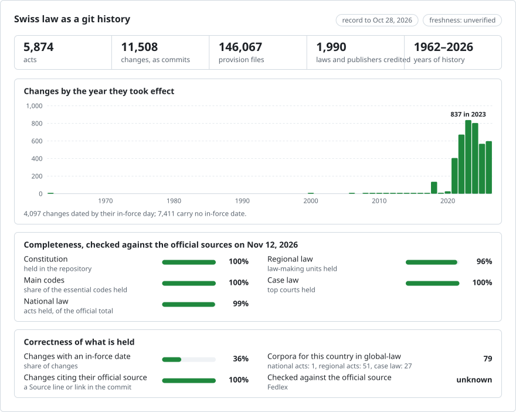

# Switzerland: law history in git

**English** · **[Oder auf Deutsch lesen](README.md)**

<picture>
<source media="(prefers-color-scheme: dark)" srcset="data/effort-dark.svg">

</picture>

The federal law of Switzerland as a git history: one file per article, one commit per amending act on the day its changes took effect, and the amending act in the Official Compilation (AS) as the commit's author. `git blame` names the act behind every paragraph; `git log` lists every change to an article; picking a date gives the text in force that day.

Part of [lexifina/global-law](https://github.com/lexifina/global-law), one git history for every country's law: this is Switzerland's federal law, which global-law reads at `switzerland/bund/acts/`.

**What is in it now:** 5,874 acts of the Classified Compilation (SR) that Fedlex publishes as structured text, 2,642 of federal law and 3,232 international treaties, with 12,121 versions and 23,602 changes to articles: 17,667 made by amending acts and 5,935 corrections of the consolidated text. Changes adopted but not yet in force, up to 2033, are on the branch `future`. [`data/erlasse.json`](data/erlasse.json) lists every act with its SR number, titles, status and versions; [`erlasse.csv`](erlasse.csv) lists every amending act with its dates.

Each act is a folder named by its SR number and each article a file (`822.11/art-046.md` is Art. 46 of the Arbeitsgesetz, the Labour Act, SR 822.11; `101/` is the Federal Constitution); an act whose SR number passed to another act is named by its ELI (`eli-2000-10`). Each paragraph is one line.

The text is in German, as Fedlex publishes it. French and Italian, equally authoritative, and Fedlex's English translations, which have no legal force, are not part of this record.

## Questions as git commands

| Question | Command |
| --- | --- |
| Every change to Art. 46 of the Labour Act | `git log -p --word-diff -- 822.11/art-046.md` |
| Which act wrote each line of Art. 46? | `git blame 822.11/art-046.md` |
| Every version of the Labour Act, with the day each took effect | `git log --date=short --format="%h %ad %an" -- "822.11/art-*"` |
| Art. 46 as in force on 1 January 2023 | `python tools/stand_am.py 2023-01-01 822.11 46` |

**Outside git**, we also host this record publicly, for free:

- **[Ask Claude about Swiss law](https://global-law.lexifina.com/v1/try_claude?country=switzerland)**: opens Claude with a first question ready.
- **[Ask ChatGPT](https://global-law.lexifina.com/v1/try_chatgpt?country=switzerland)**: the same question in ChatGPT.
- **[Search Swiss law on our site](https://lexifina.com/law?country=switzerland&q=Ferien)**: a search for "Ferien", with each provision's text and its versions, no account needed.
- **[Developer REST API](https://global-law.lexifina.com/v1/search_law?query=Ferien&jurisdiction=switzerland)**: the same search as JSON, with no key. See the [documentation here](https://lexifina.com/api/global-law).

Both assistants read the record through the free Global law connector (MCP, `https://global-law.lexifina.com/mcp`); the first time, the chat gives you the link that adds it. Ask in German or in English.

**Host it yourself easily.** All it takes is git and Python, and the tools run on your machine:

```sh
git clone --depth 1 https://github.com/lexifina/global-law && cd global-law
python3 tools/countries.py add switzerland/bund/acts
python3 tools/law.py show 2026-01-01 switzerland/bund/acts/822.11/art-046.md
```

Opened in Claude Code, Cursor, VS Code or Codex, the clone also starts a local MCP server with the same tools ([MCP.md](https://github.com/lexifina/global-law/blob/main/MCP.md)).

## Dates

Each commit is dated at noon, Europe/Zurich, on the day the change took effect, and carries it in its `In-force:` trailer, with `Adopted:`, `Vote:` where there was one, and `Published:`:

- the day comes from the footnote under the article ("in Kraft seit …") or from Fedlex's record of which act changed that article, and is never on or before the previous version; where Fedlex has structured text for only some versions, the version where a change first appears can be later than that day;
- each act starts with its first structured version, for most acts in 2021 (trailer `Consolidated:`); corrections carry `Corrected:`;
- git cannot store dates before 1970, so the 536 earlier commits are dated 1970-01-01, one second apart, with the real day in the subject line and the trailer.

Each change is credited to the amending act that Fedlex's records or the article's footnote ("Fassung gemäss …", "Eingefügt durch …") name, such as `AS 2022 491 (DSG)`; each act's first version, and every change no act is named for, is by `Bundeskanzlei (Fedlex)`. Dates found wrong later are recorded in appended commits (`Redates:` trailer).

## How it is checked

- `tools/check_repo.py` reads every version of every article back from git on the day it took effect, and the version before it on the day before, and compares them with the text built from Fedlex.
- Every word, date and title is copied from Fedlex by the tools; a difference of typesetting alone ("..." and "…") is not a change.
- [`data/versionen.json`](data/versionen.json) lists every Fedlex XML file used with its SHA-256; `tools/bulk.py` gives the same commits with the same hashes from the same data ([`REPRODUCE.md`](REPRODUCE.md)).
- A new build replaces the history, so hashes can change between builds: update a clone with `git fetch --force --tags origin && git reset --hard origin/main`.

## What it does not show

- **Versions before the structured text.** Fedlex has most versions before 2021 only as PDF or Word files; their text is not here, and an act's history starts later than the act (the Labour Act of 1964 from 2021).
- **Annexes and tables**, and the 49 acts whose XML holds no articles (listed in `REPRODUCE.md`).
- **Transitional rules of amending acts** ("für hängige Verfahren gilt bisheriges Recht"), which are in the AS, not in the consolidated text.
- **Whether a whole act is still in force.** 520 acts Fedlex marks as no longer in force keep their last text on `main`; `data/erlasse.json` gives each act's status.
- **Cantonal and communal law and case law** are in their own repositories, listed in global-law's [switzerland/REPOSITORIES.md](https://github.com/lexifina/global-law/blob/main/switzerland/REPOSITORIES.md).

## Sources

| Source | Kind | Past versions | Notes |
| --- | --- | --- | --- |
| [Fedlex](https://www.fedlex.admin.ch) (Federal Chancellery) | Classified Compilation (SR), consolidated; Official Compilation (AS) for the amending acts | yes, every version published as structured text | Its open linked data (SPARQL, JOLux) and the Akoma Ntoso XML of each version; only the AS is authoritative |

## Licence

See [`LICENSE`](LICENSE). Enactments and official texts of the Confederation are not protected by copyright (Art. 5 para. 1 let. a of the Copyright Act, URG, SR 231.1); the history, commit messages, tables and tools are CC0 1.0.

No AI model wrote or changed legal text; the tools were written by an AI model (see [`REPRODUCE.md`](REPRODUCE.md)).

## More

From [lexifina/global-law](https://github.com/lexifina/global-law):

- [FEATURES.md](https://github.com/lexifina/global-law/blob/main/FEATURES.md): every feature, and what every corpus must support (`git blame`, `law.py`, the MCP tools)
- [FAQ.md](https://github.com/lexifina/global-law/blob/main/FAQ.md): questions and answers · [CONTRIBUTING.md](https://github.com/lexifina/global-law/blob/main/CONTRIBUTING.md): proposing changes · [MCP.md](https://github.com/lexifina/global-law/blob/main/MCP.md): the MCP server · [REPRODUCE.md](https://github.com/lexifina/global-law/blob/main/REPRODUCE.md): how it was built · [CHANGELOG.md](https://github.com/lexifina/global-law/blob/main/CHANGELOG.md)
- [FRESHNESS.md](https://github.com/lexifina/global-law/blob/main/FRESHNESS.md): how current each corpus is · [Monitoring](https://github.com/lexifina/global-law/tree/main/monitoring): whether updates are running · [WATCHING.md](https://github.com/lexifina/global-law/blob/main/WATCHING.md): how each official source is watched for changes
- [performance/](https://github.com/lexifina/global-law/tree/main/performance): how fast the tools are, measured
- [visualisations/](https://github.com/lexifina/global-law/tree/main/visualisations): charts and bridges across the world's law
- [Vulnerabilities](https://github.com/lexifina/global-law/tree/main/vulnerabilities): mistakes in legislation as published
