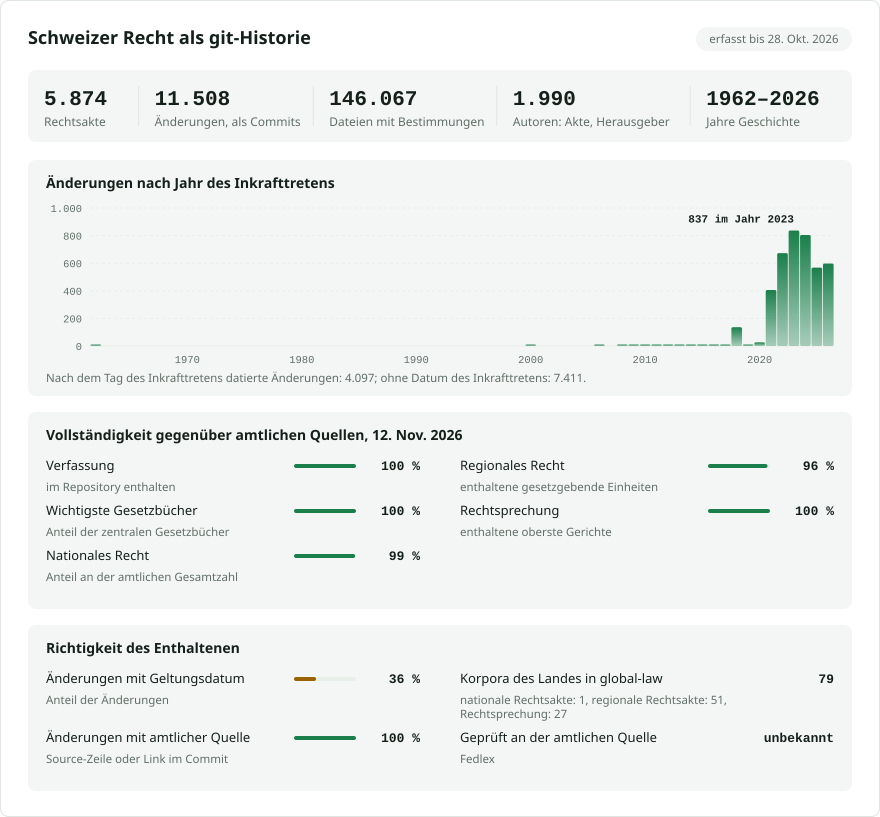

# Schweiz: Rechtsgeschichte in Git

**Deutsch** · **[Or read it in English](README.en.md)**

<picture>
<source media="(prefers-color-scheme: dark)" srcset="data/de/effort-dark.svg">

</picture>

Das Bundesrecht der Schweiz als Git-Historie: eine Datei je Artikel, ein Commit je Änderungserlass an dem Tag, an dem seine Änderungen in Kraft getreten sind, und als Autor des Commits der Änderungserlass in der Amtlichen Sammlung (AS). `git blame` nennt zu jedem Absatz den Erlass, der ihn geschrieben hat; `git log` listet jede Änderung eines Artikels auf; ein gewähltes Datum ergibt den an diesem Tag geltenden Text.

Teil von [lexifina/global-law](https://github.com/lexifina/global-law), einer Git-Historie für das Recht aller Länder: Dies ist das Bundesrecht der Schweiz, das global-law unter `switzerland/bund/acts/` liest.

**Was es jetzt enthält:** 5’874 Erlasse der Systematischen Rechtssammlung (SR), die Fedlex als strukturierten Text veröffentlicht, 2’642 des Landesrechts und 3’232 Staatsverträge, mit 12’121 Fassungen und 23’602 Änderungen an Artikeln: 17’667 durch Änderungserlasse und 5’935 Berichtigungen des konsolidierten Texts. Beschlossene, aber noch nicht in Kraft getretene Änderungen, bis 2033, liegen im Zweig `future`. [`data/erlasse.json`](data/erlasse.json) führt jeden Erlass mit SR-Nummer, Titeln, Status und Fassungen an; [`erlasse.csv`](erlasse.csv) führt jeden Änderungserlass mit seinen Daten an.

Jeder Erlass ist ein Ordner, benannt nach seiner SR-Nummer, und jeder Artikel eine Datei (`822.11/art-046.md` ist Art. 46 des Arbeitsgesetzes, SR 822.11; `101/` ist die Bundesverfassung); ein Erlass, dessen SR-Nummer auf einen anderen Erlass übergegangen ist, ist nach seiner ELI benannt (`eli-2000-10`). Jeder Absatz ist eine Zeile.

Der Text ist auf Deutsch, so wie ihn Fedlex veröffentlicht. Der französische und der italienische Wortlaut, die gleichermassen massgebend sind, und die englischen Übersetzungen auf Fedlex, die keine Rechtskraft haben, sind nicht Teil dieses Bestands.

## Fragen als Git-Befehle

| Frage | Befehl |
| --- | --- |
| Jede Änderung von Art. 46 des Arbeitsgesetzes | `git log -p --word-diff -- 822.11/art-046.md` |
| Welcher Erlass hat jede Zeile von Art. 46 geschrieben? | `git blame 822.11/art-046.md` |
| Jede Fassung des Arbeitsgesetzes, mit dem Tag ihres Inkrafttretens | `git log --date=short --format="%h %ad %an" -- "822.11/art-*"` |
| Art. 46 in der am 1. Januar 2023 geltenden Fassung | `python tools/stand_am.py 2023-01-01 822.11 46` |

**Ausserhalb von Git** stellen wir diesen Bestand auch öffentlich und kostenlos bereit:

- **[Claude zum Schweizer Recht fragen](https://global-law.lexifina.com/v1/try_claude?country=switzerland)**: öffnet Claude mit einer vorbereiteten ersten Frage.
- **[ChatGPT fragen](https://global-law.lexifina.com/v1/try_chatgpt?country=switzerland)**: dieselbe Frage in ChatGPT.
- **[Im Schweizer Recht auf unserer Website suchen](https://lexifina.com/law?country=switzerland&q=Ferien)**: eine Suche nach «Ferien», mit dem Text jeder Vorschrift und ihren Fassungen, ohne Konto.
- **[REST-API für Entwickler](https://global-law.lexifina.com/v1/search_law?query=Ferien&jurisdiction=switzerland)**: dieselbe Suche als JSON, ohne Schlüssel. Die Dokumentation finden Sie [hier](https://lexifina.com/api/global-law).

Beide Assistenten lesen den Bestand über den kostenlosen Connector Global law (MCP, `https://global-law.lexifina.com/mcp`); beim ersten Mal gibt Ihnen der Chat den Link, mit dem Sie ihn hinzufügen. Fragen Sie auf Deutsch oder auf Englisch.

**Ganz einfach selbst betreiben.** Sie brauchen nur Git und Python, und die Werkzeuge laufen auf Ihrem Rechner:

```sh
git clone --depth 1 https://github.com/lexifina/global-law && cd global-law
python3 tools/countries.py add switzerland/bund/acts
python3 tools/law.py show 2026-01-01 switzerland/bund/acts/822.11/art-046.md
```

In Claude Code, Cursor, VS Code oder Codex geöffnet, startet der Klon auch einen lokalen MCP-Server mit denselben Werkzeugen ([MCP.md](https://github.com/lexifina/global-law/blob/main/MCP.md)).

## Datumsangaben

Jeder Commit ist mit 12 Uhr Zürcher Zeit (Europe/Zurich) des Tages datiert, an dem die Änderung in Kraft getreten ist, und trägt diesen Tag in seinem `In-force:`-Trailer, dazu `Adopted:`, `Vote:`, wo es eine Volksabstimmung gab, und `Published:`:

- der Tag stammt aus der Fussnote unter dem Artikel («in Kraft seit …») oder aus den Angaben von Fedlex darüber, welcher Erlass diesen Artikel geändert hat, und liegt nie auf oder vor der vorherigen Fassung; wo Fedlex nur für einige Fassungen strukturierten Text hat, kann die Fassung, in der eine Änderung zuerst erscheint, später liegen als dieser Tag;
- jeder Erlass beginnt mit seiner ersten strukturierten Fassung, bei den meisten Erlassen 2021 (Trailer `Consolidated:`); Berichtigungen tragen `Corrected:`;
- Git kann keine Daten vor 1970 speichern, daher sind die 536 früheren Commits auf den 1970-01-01 datiert, jeweils eine Sekunde auseinander, mit dem tatsächlichen Tag in der Betreffzeile und im Trailer.

Jede Änderung wird dem Änderungserlass zugeschrieben, den die Angaben von Fedlex oder die Fussnote des Artikels («Fassung gemäss …», «Eingefügt durch …») nennen, etwa `AS 2022 491 (DSG)`; die erste Fassung jedes Erlasses und jede Änderung, für die kein Erlass genannt ist, stammen von `Bundeskanzlei (Fedlex)`. Später als falsch erkannte Daten werden in angehängten Commits festgehalten (Trailer `Redates:`).

## Wie geprüft wird

- `tools/check_repo.py` liest jede Fassung jedes Artikels am Tag ihres Inkrafttretens aus Git zurück, ebenso die vorherige Fassung am Vortag, und vergleicht beide mit dem aus Fedlex erstellten Text.
- Jedes Wort, jedes Datum und jeder Titel wird von den Werkzeugen aus Fedlex übernommen; ein blosser Unterschied im Schriftsatz («...» und «…») ist keine Änderung.
- [`data/versionen.json`](data/versionen.json) führt jede verwendete XML-Datei von Fedlex mit ihrem SHA-256 an; `tools/bulk.py` ergibt aus denselben Daten dieselben Commits mit denselben Hashes ([`REPRODUCE.md`](REPRODUCE.md)).
- Ein neuer Build ersetzt die Historie, daher können sich Hashes zwischen Builds ändern: Einen Klon aktualisieren Sie mit `git fetch --force --tags origin && git reset --hard origin/main`.

## Was es nicht zeigt

- **Fassungen vor dem strukturierten Text.** Fedlex hat die meisten Fassungen vor 2021 nur als PDF- oder Word-Datei; ihr Text ist nicht enthalten, und die Historie eines Erlasses beginnt später als der Erlass (das Arbeitsgesetz von 1964 ab 2021).
- **Anhänge und Tabellen** sowie die 49 Erlasse, deren XML keine Artikel enthält (aufgeführt in `REPRODUCE.md`).
- **Übergangsbestimmungen von Änderungserlassen** («für hängige Verfahren gilt bisheriges Recht»), die in der AS stehen, nicht im konsolidierten Text.
- **Ob ein ganzer Erlass noch in Kraft ist.** 520 Erlasse, die Fedlex als nicht mehr in Kraft kennzeichnet, behalten ihren letzten Text in `main`; `data/erlasse.json` gibt den Status jedes Erlasses an.
- **Kantonales und kommunales Recht sowie Rechtsprechung** liegen in eigenen Repositorys, aufgeführt in [switzerland/REPOSITORIES.md](https://github.com/lexifina/global-law/blob/main/switzerland/REPOSITORIES.md) von global-law.

## Quellen

| Quelle | Art | Frühere Fassungen | Anmerkungen |
| --- | --- | --- | --- |
| [Fedlex](https://www.fedlex.admin.ch) (Bundeskanzlei) | Systematische Rechtssammlung (SR), konsolidiert; Amtliche Sammlung (AS) für die Änderungserlasse | ja, jede als strukturierter Text veröffentlichte Fassung | Seine offenen verknüpften Daten (SPARQL, JOLux) und das Akoma-Ntoso-XML jeder Fassung; massgebend ist allein die AS |

## Lizenz

Siehe [`LICENSE`](LICENSE). Erlasse und amtliche Texte des Bundes sind urheberrechtlich nicht geschützt (Art. 5 Abs. 1 Bst. a Urheberrechtsgesetz, URG, SR 231.1); die Historie, die Commit-Nachrichten, die Tabellen und die Werkzeuge stehen unter CC0 1.0.

Kein KI-Modell hat Rechtstext geschrieben oder geändert; die Werkzeuge wurden von einem KI-Modell geschrieben (siehe [`REPRODUCE.md`](REPRODUCE.md)).

Dies ist eine Übersetzung der englischen Fassung ([README.en.md](README.en.md)); bei Abweichungen gilt die englische Fassung.

## Mehr

Aus dem Repository [lexifina/global-law](https://github.com/lexifina/global-law) (auf Englisch):

- [FEATURES.md](https://github.com/lexifina/global-law/blob/main/FEATURES.md): alle Funktionen und was jedes Korpus unterstützen muss (`git blame`, `law.py`, MCP-Werkzeuge)
- [FAQ.md](https://github.com/lexifina/global-law/blob/main/FAQ.md): Fragen und Antworten · [CONTRIBUTING.md](https://github.com/lexifina/global-law/blob/main/CONTRIBUTING.md): Änderungen vorschlagen · [MCP.md](https://github.com/lexifina/global-law/blob/main/MCP.md): MCP-Server · [REPRODUCE.md](https://github.com/lexifina/global-law/blob/main/REPRODUCE.md): wie es erstellt wurde · [CHANGELOG.md](https://github.com/lexifina/global-law/blob/main/CHANGELOG.md)
- [FRESHNESS.md](https://github.com/lexifina/global-law/blob/main/FRESHNESS.md): wie aktuell jedes Korpus ist · [Überwachung](https://github.com/lexifina/global-law/tree/main/monitoring): ob die Aktualisierungen funktionieren · [WATCHING.md](https://github.com/lexifina/global-law/blob/main/WATCHING.md): wie jede amtliche Quelle auf Änderungen überwacht wird
- [performance/](https://github.com/lexifina/global-law/tree/main/performance): wie schnell die Werkzeuge sind, gemessen
- [visualisations/](https://github.com/lexifina/global-law/tree/main/visualisations): Diagramme und Verbindungen im Recht der ganzen Welt
- [Schwachstellen](https://github.com/lexifina/global-law/tree/main/vulnerabilities): Fehler in Rechtsakten, wie sie veröffentlicht wurden
